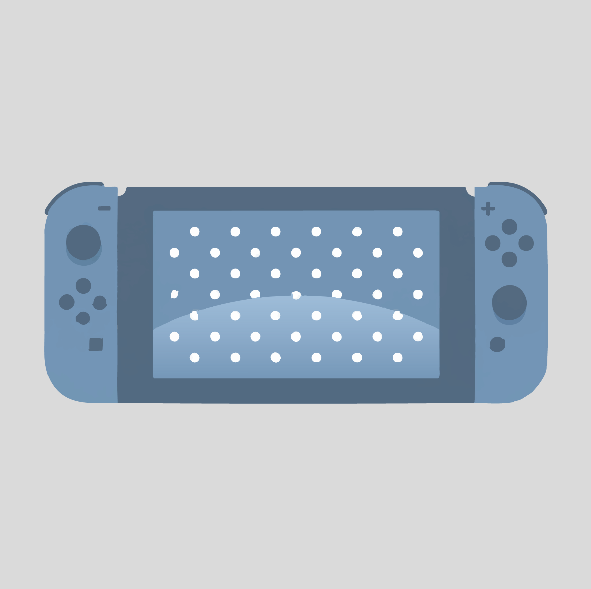
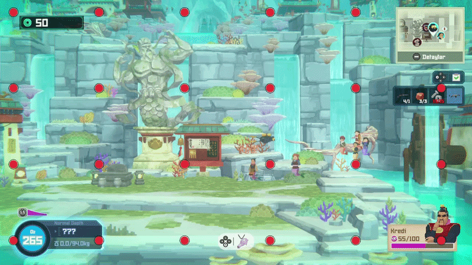
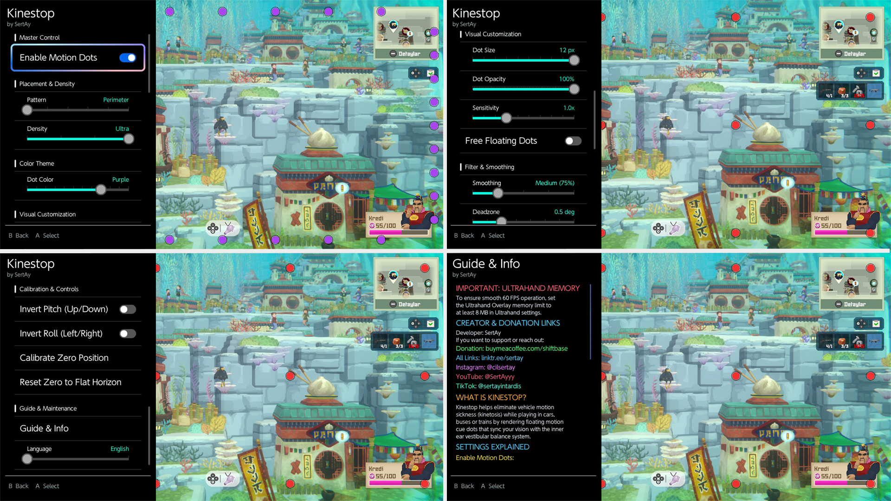
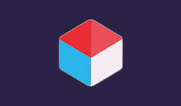
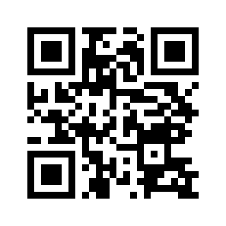
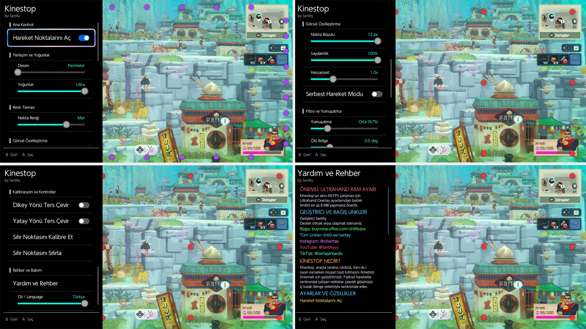

<h1 align="center">Kinestop v2.0.0</h1>

---

<b>(EN)</b> Kinestop is an anti-motion sickness (kinetosis) overlay for the Nintendo Switch. It renders smooth 60 FPS floating motion cues synchronized with the console's hardware sensors, preventing nausea while playing in cars, buses, and trains.
  
<b>(TR)</b> Kinestop, Nintendo Switch için araç tutmasını (kinetoz) önleyen bir hareket takip aracıdır. Konsolun donanım sensörleriyle senkronize 60 FPS hareket noktaları çizerek, araba, otobüs veya trende oyun oynarken oluşan mide bulantısını engeller.

  

 &nbsp;&nbsp; 

---

## (EN) Setup and Usage Guide

### ✨ Features
* **Prevents Motion Sickness:** 60 FPS floating motion cues sync with physical vehicle motion to eliminate nausea.
* **4MB Ultrahand Memory Supported:** Runs natively within Ultrahand's default 4MB memory limit (no crash, no 8MB memory change needed!).
* **Universal 100% Game Compatibility:** Direct motherboard IMU sensor integration works across all games and the Switch Home Menu.
* **Instant Launch & Play:** Selecting **Motion Dots** immediately closes the panel and renders cues over your game.
* **Auto Zero Calibration:** Automatically locks your current holding angle as the level horizon on launch (**Calibrate on Start**).
* **Free Floating Horizon Mode:** Dots drift naturally beyond screen edges for an authentic horizon view.
* **Clean Captures:** Dots do not appear in screenshots or 30s video captures unless enabled in settings.
* **Visual Customization:** 12 color themes, 6 placement patterns, dot size, and opacity options.
* **Adjustable Sensitivity:** 10 sensitivity levels (0.2x - 6.0x) with hand tremor smoothing.
* **Full Bilingual Support:** Complete English and Turkish interface with instant in-menu switching.

  

### 💾 Step 1: Installation
**Requirements:** You MUST have [nx-ovlloader](https://github.com/ppkantorski/nx-ovlloader) and [Ultrahand-Overlay](https://github.com/ppkantorski/Ultrahand-Overlay) installed on your system!

**Method 1: Homebrew App Store (Automatic Installation)**
You can download and install the application directly on your Switch via the HB App Store.

  <a href="https://hb-app.store/switch/Kinestop">
  
   
  <a href="https://apps.fortheusers.org/switch/Kinestop">HB Store Download Link</a>

 

**Method 2: Manual Installation**
1. Download the [latest release](https://github.com/sertay1/Kinestop/releases) `Kinestop.zip` file.
2. Extract it and drag the contents of `sdcard/` directly to the root of your SD card:
   - `sdcard/switch/.overlays/kinestop.ovl` ➔ `SD:/switch/.overlays/kinestop.ovl`

### 🎮 Step 2: How to Use
1. **Open UltraHand:** While in-game, press your UltraHand combo (default: `ZL + ZR + D-Pad Down` or `L + R + D-Pad Down + R3`).
2. **Launch Kinestop:** Select Kinestop from the overlay list.
3. **Configure Settings:** Choose your preferred color theme, pattern, size, and sensitivity.
4. **Start Motion Dots:** Select **Motion Dots** (the first item). The panel will close immediately, controls return 100% to your game, and motion cues float over gameplay at 60 FPS!
5. **Adjust Settings / Exit:**
   - Press the UltraHand combo again to stop dots and bring back the Kinestop settings menu.
   - Press **(B)** in the settings menu to return to the UltraHand menu.

---

## 🌟 Special Thanks
Special thanks to **[RandomTask-1](https://github.com/RandomTask-1)** for the 4MB Ultrahand memory optimization and display strategy contributions!

---

## 🔗 Contact and Donate

### SertAy

| Links | QR Code |
| :--- | :--- |
| **All Links:** [My Linktree](https://linktr.ee/yamanx) |  |

---

## (TR) Kurulum ve Kullanım Rehberi

### ✨ Özellikler
* **Taşıt Tutmasını Önleme:** Fiziksel araç hareketiyle senkronize 60 FPS hareket noktalarıyla mide bulantısını engeller.
* **4MB Bellek Desteği:** Ultrahand'in varsayılan 4MB belleğiyle sorunsuz çalışır (Ultrahand ayarlarından belleği 8MB yapma zorunluluğu kalktı!).
* **%100 Oyun Desteği:** Konsolun anakart sensörüne doğrudan bağlandığı için bütün oyunlarda ve Switch Ana Menüsünde çalışır.
* **Tek Tuşla Başlatma:** Panelin en üstündeki **Hareket Noktaları** seçeneğine bastığınız an panel kapanır ve noktalar anında oyunun üstünde akmaya başlar.
* **Başlarken Otomatik Kalibrasyon:** Noktaları başlattığınız anda konsolu tutuş açınızı otomatik olarak merkez ufuk seviyesi kabul eder (**Başlarken Kalibre Et**).
* **Serbest Hareket Modu:** Noktaların pencereden bakar gibi ekran dışına doğal süzülmesini sağlar.
* **Temiz Kayıt:** İsteğe bağlı olarak noktalar aldığınız ekran görüntülerinde ve videolarda görünmez.
* **Görsel Kişiselleştirme:** 12 renk teması, 6 yerleşim şablonu, boyut ve saydamlık seçenekleri.
* **Hassasiyet Ayarı:** 10 kademeli hassasiyet (0.2x - 6.0x) ve el titremesini filtreleme desteği.
* **Tam Dil Desteği:** Türkçe ve İngilizce dil desteği ve menüden anlık dil değiştirme.

  

### 💾 1. Aşama: Kurulum
**Zorunlu Gereksinimler:** Uygulamanın çalışması için cihazınızda [nx-ovlloader](https://github.com/ppkantorski/nx-ovlloader) ve [Ultrahand-Overlay](https://github.com/ppkantorski/Ultrahand-Overlay) yüklü olmak ZORUNDADIR!

**Yöntem 1: Homebrew App Store (Otomatik Kurulum)**
Uygulamayı doğrudan Switch üzerinden HB App Store aracılığıyla indirip kurabilirsiniz.

  <a href="https://hb-app.store/switch/Kinestop">
  
   
  <a href="https://apps.fortheusers.org/switch/Kinestop">HB Store İndirme Linki</a>

 

**Yöntem 2: Manuel Kurulum**
1. İndirdiğiniz [en güncel sürüm](https://github.com/sertay1/Kinestop/releases) `Kinestop.zip` dosyasını bilgisayara çıkartın.
2. Çıkan `sdcard/` klasörü içindeki dosyaları doğrudan SD kartınızın ana dizinine sürükleyip bırakın:
   - `sdcard/switch/.overlays/kinestop.ovl` ➔ `SD:/switch/.overlays/kinestop.ovl`

### 🎮 2. Aşama: Uygulamanın Kullanımı
1. **UltraHand'i Açın:** Oyundayken UltraHand kısayolunuza (`ZL + ZR + D-Pad Aşağı` veya `L + R + D-Pad Aşağı + Sağ Analog`) basın.
2. **Kinestop'u Başlatın:** Listeden Kinestop'u seçin.
3. **Ayarlayın:** İstediğiniz rengi, yerleşim şablonunu ve hassasiyeti belirleyin.
4. **Hareket Noktalarını Başlatın:** En üstteki **Hareket Noktaları** seçeneğine basın; panel anında kapanır ve noktalar 60 FPS akıcılıkla oyunun üzerinde süzülmeye başlar.
5. **Menüye Dönüş / Çıkış:**
   - Noktalar ekrandayken UltraHand kısayoluna basarak noktaları durdurup Kinestop menüsüne dönebilirsiniz.
   - Menüdeyken **(B)** tuşuna basarak doğrudan UltraHand menüsüne çıkabilirsiniz.

---

## 🌟 Teşekkürler
4 MB’lık Ultrahand bellek optimizasyonu ve görüntüleme stratejisi konusundaki katkıları için **[RandomTask-1](https://github.com/RandomTask-1)**’e özel teşekkürler!

---

## 🔗 İletişim ve Bağış

### SertAy

| Linkler | QR Kod |
| :--- | :--- |
| **Tüm Linkler:** [Linktree Sayfam](https://linktr.ee/yamanx) |  |

---

## 📄 License / Lisans

Telif Hakkı — © 2026 **SertAy**.  
Bu proje kişisel ve ticari olmayan kullanım için açıktır. Projenin kaynak belirtilmeksizin paylaşılması, sahiplenilmesi veya satılması kesinlikle yasaktır. Detaylar için lütfen [LICENSE](LICENSE) dosyasını inceleyiniz.

Copyright (c) 2026 **SertAy**.  
This project is available for personal and non-commercial use with mandatory author attribution. Claiming authorship, unauthorized redistribution, or selling this software is strictly prohibited. Please see the [LICENSE](LICENSE) file for details.
